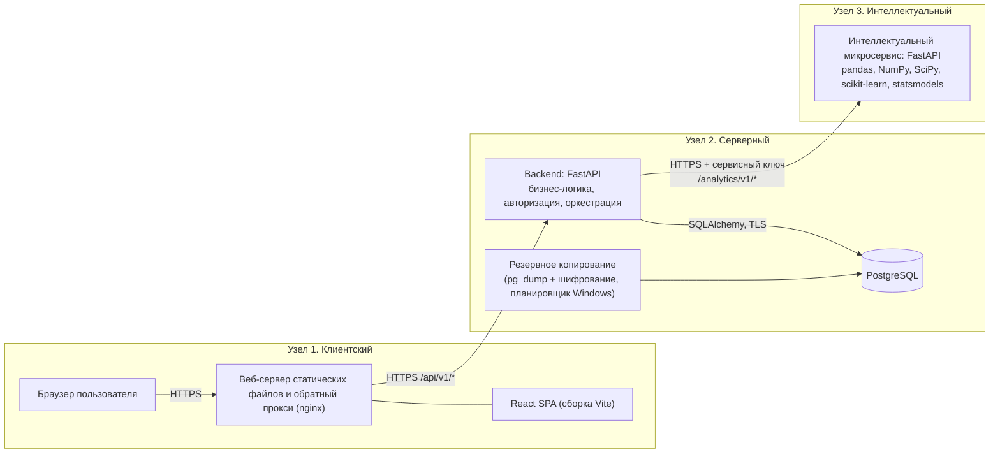
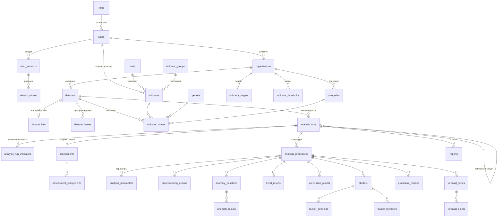

# Архитектура программного средства «Кризис. Аналитика»

Программное средство анализа и визуализации многомерных данных в кризисном управлении.

Документ — результат этапа анализа требований и проектирования. Источники:

- **[ЛЗ]** — лист задания по курсовому проекту (утв. 15.09.2026), файл `Малец лист задания.pdf`;
- **[ПЗ]** — пояснительная записка, файл `КУРСАЧ.pdf` (разделы 1–2, 69 с.);
- **[РИ]** — изображение интерфейса «Кризис. Аналитика» (визуальный референс).

Каждое положение в документе помечено одной из трёх меток:

| Метка | Значение |
|---|---|
| **ОБЯЗ** | Обязательное требование, прямо следующее из [ЛЗ] или [ПЗ] (указан источник) |
| **ПР** | Проектное решение: способ выполнить обязательные требования, выбранный при проектировании; требует согласования, но не является новым требованием |
| **ДОП** | Дополнительное улучшение, которого нет в документах; реализуется только после согласования и при наличии времени |

---

## 0. Расхождение с пояснительной запиской: MATLAB → Python

### 0.1 Что сказано в пояснительной записке

- [ПЗ, с. 37, разд. 1.5]: «В качестве основной программной среды разработки предусматривается MATLAB. Он используется для обработки многомерных данных, реализации выбранных статистических и интеллектуальных методов, а также построения визуализаций».
- [ПЗ, с. 28, разд. 1.4] методы описаны через функции MATLAB: `isoutlier` (медиана/MAD), `corrcoef` (корреляционная матрица и p-значения), `kmeans`, `silhouette`, `evalclusters`. Источники [14], [18], [19] — документация MathWorks.

### 0.2 Что предлагается в проекте

Интеллектуальный компонент реализуется как изолированный микросервис на **Python + FastAPI** со стеком pandas, NumPy, SciPy, scikit-learn и statsmodels. Визуализация выполняется не в MATLAB, а на клиенте (React + Recharts).

**Это расхождение с текстом [ПЗ]. Его нужно согласовать с руководителем и отразить в разделе 4.3.2 «Обоснование и выбор технологического стека», а также поправить формулировку в разделе 1.5.**

### 0.3 Обоснование (для согласования с руководителем)

1. **Требование [ЛЗ, п. 3.2.1] об изолированном микросервисе на отдельном физическом узле.** Интеллектуальный компонент должен принимать запросы по сети. В Python это делается штатно (FastAPI + uvicorn). У MATLAB для этого есть два пути: MATLAB Production Server (отдельный коммерческий продукт) или MATLAB Compiler/Compiler SDK с бесплатным MATLAB Runtime. Второй путь всё равно требует лицензий Compiler и тулбоксов на этапе сборки, а HTTP-обёртку пришлось бы писать на другом языке.
2. **Требование [ЛЗ, п. 3.3]: работа в Windows 11 без IDE, с предустановкой библиотек.** Python-сервис ставится скриптом (`venv` + `pip install -r requirements.txt`) и запускается из командной строки. Для MATLAB на интеллектуальном узле нужен установленный MATLAB с лицензией либо MATLAB Runtime для скомпилированного компонента. Это усложняет развёртывание и проверку проекта на машинах кафедры.
3. **Требование [ЛЗ, п. 3.2.4] об актуальности версий на январь 2026.** У открытых библиотек версии и даты выпуска публичны и легко проверяются (PyPI). Для MATLAB пришлось бы подтверждать наличие лицензии конкретного релиза (R2025b).
4. **Методы из [ПЗ] переносятся без изменения математики.** Выбранный в [ПЗ] гибридный статистико-интеллектуальный подход остаётся прежним. Меняется только среда реализации. Соответствие функций:

   | Метод в [ПЗ] | MATLAB | Python-эквивалент |
   |---|---|---|
   | Выбросы по медиане и MAD (формула 3, [17]) | `isoutlier(x, "median")` (порог — 3 масштабированных MAD) | `scipy.stats.median_abs_deviation(x, scale="normal")` + порог τ |
   | Стандартизация (формула 2) | `zscore` | `scipy.stats.zscore` / `sklearn.preprocessing.StandardScaler` |
   | Корреляционная матрица и p-значения (формула 4) | `corrcoef` | `numpy.corrcoef`, `scipy.stats.pearsonr` / `spearmanr` |
   | k-средних (формула 5) | `kmeans` | `sklearn.cluster.KMeans` |
   | Выбор числа кластеров | `silhouette`, `evalclusters` | `sklearn.metrics.silhouette_score` |
   | Экспоненциальное сглаживание (формула 6) | Econometrics / собственная реализация | `statsmodels.tsa.holtwinters.SimpleExpSmoothing`, `ExponentialSmoothing` |
   | Метрики прогноза MAE, RMSE, MAPE | собственный код | `sklearn.metrics` |
5. **Единый язык для сервера и интеллектуального компонента.** Это упрощает общий подход к валидации данных (Pydantic), тестированию (pytest) и описанию программных интерфейсов (OpenAPI генерируется автоматически). Это важно для раздела 4.3.6 и плаката 6.5.
6. **Лицензирование.** Все компоненты распространяются под открытыми лицензиями (BSD, MIT, Apache, PostgreSQL License). Это позволяет приложить к ПЗ полный текст программы [ЛЗ, раздел «Приложения»] и развернуть систему без лицензионных ограничений.

**Риски перехода и как их снять:**

- Текст [ПЗ] (разд. 1.4 и 1.5) и ссылки [14], [18], [19] нужно переписать: ссылки можно сохранить как описание методов и дополнить документацией SciPy, scikit-learn и statsmodels.
- Результаты могут незначительно отличаться от MATLAB (разные значения по умолчанию у порогов MAD, инициализации k-средних, оптимизации α). Это снимается явной фиксацией параметров и `random_state`, что одновременно выполняет требование воспроизводимости [ПЗ, NFR-05, REP-1].

**Варианты для обсуждения с руководителем:**

- **А (предлагается).** Python полностью заменяет MATLAB. Разделы 1.4 и 1.5 ПЗ корректируются.
- **Б.** Python — среда реализации, MATLAB (если доступна лицензия) — среда экспериментальной проверки методов. На тестовых наборах результаты Python-сервиса сравниваются с `isoutlier`, `corrcoef`, `kmeans`, и это сравнение входит в раздел 4.4.3. Текст ПЗ меняется минимально.
- **В.** Реализация на MATLAB (через MATLAB Production Server или скомпилированный компонент и Python-обёртку). Не рекомендуется по причинам 1–3.

---

## 1. Требования

### 1.1 Обязательные требования листа задания

| ID | Требование | Источник |
|---|---|---|
| ЛЗ-01 | ПС состоит из клиентского, серверного и интеллектуального компонентов, расположенных на разных физических узлах | ЛЗ 3.2.1 |
| ЛЗ-02 | Классическая бизнес-логика реализуется **только** на серверной части | ЛЗ 3.2.1 |
| ЛЗ-03 | Интеллектуальная составляющая — изолированный микросервис | ЛЗ 3.2.1 |
| ЛЗ-04 | Реализовать архитектурные паттерны интеграции ИИ | ЛЗ 3.2.1 |
| ЛЗ-05 | При реляционной модели данных — нормализация до 3НФ | ЛЗ 3.2.2 |
| ЛЗ-06 | Функции авторизации пользователей | ЛЗ 3.2.3 |
| ЛЗ-07 | Версии фреймворков и технологий актуальны на январь 2026 года | ЛЗ 3.2.4 |
| ЛЗ-08 | Работа в ОС Windows 11; допускается предустановка библиотек и пакетов | ЛЗ 3.3 |
| ЛЗ-09 | Запуск без интегрированных средств разработки | ЛЗ 3.3 |
| ЛЗ-10 | Документация: руководство по установке (развёртыванию) и руководство по работе для всех категорий пользователей | ЛЗ 3.3, 4.5 |
| ЛЗ-11 | Защита хранимых и передаваемых данных (шифрование, резервное копирование) | ЛЗ 3.4.1 |
| ЛЗ-12 | Пароли пользователей хранятся в зашифрованном виде | ЛЗ 3.4.2 |
| ЛЗ-13 | Интерфейс и подписи на схемах и диаграммах — только на русском языке (кроме имён классов, переменных, методов, атрибутов) | ЛЗ 3.6 |
| ЛЗ-14 | Графический материал: BPMN, архитектура, модель данных, бизнес-логика, модели интерфейсов и интеграции, скриншоты (по 1 листу А3) | ЛЗ 6 |
| ЛЗ-15 | Нотации BPMN 2.0 и UML 2.0+ | ЛЗ 3.5.6 |
| ЛЗ-16 | Текст программы — обязательное приложение | ЛЗ 4 |

### 1.2 Функциональные требования из пояснительной записки

В [ПЗ] два перечня функциональных требований: табл. 1.11 (FR-01…FR-14) и табл. 2.9 (FR-1…FR-11, с трассировкой к вариантам использования). За основу взята **табл. 2.9** как более поздняя спецификация. Требования табл. 1.11 и разд. 1.3, которых нет в табл. 2.9, добавлены отдельными строками со ссылкой на источник.

| ID | Требование | Источник | UC |
|---|---|---|---|
| FR-1 | Загрузка исходного набора многомерных данных и проверка его соответствия установленной структуре | ПЗ 2.9; 1.11 FR-01, FR-02 | UC-1 |
| FR-2 | Выбор показателей, периода исследования и параметров аналитических процедур | ПЗ 2.9; 1.11 FR-04, FR-13 | UC-2 |
| FR-3 | Предварительная обработка: проверка, очистка, обработка пропусков и некорректных значений, приведение к сопоставимому виду (стандартизация) | ПЗ 2.9; 1.11 FR-03; формула 2 | UC-3 |
| FR-4 | Выявление аномальных значений показателей | ПЗ 2.9; 1.11 FR-06; формула 3 | UC-3.1 |
| FR-5 | Определение взаимосвязей между показателями и представление результатов | ПЗ 2.9; 1.11 FR-07; формула 4 | UC-3.2 |
| FR-6 | Кластеризация периодов или наблюдений по сходству характеристик | ПЗ 2.9; 1.11 FR-08; формула 5 | UC-3.3 |
| FR-7 | Прогнозирование динамики показателей при достаточной истории | ПЗ 2.9; 1.11 FR-09; формула 6 | UC-3.4 |
| FR-8 | Объединение результатов процедур в единую информационную картину (сводная оценка состояния) | ПЗ 2.9; 1.11 FR-11; формулы 7, 9, 10 | UC-3 |
| FR-9 | Визуализация результатов: графики, таблицы, диаграммы | ПЗ 2.9; 1.11 FR-10 | UC-4 |
| FR-10 | Последовательный просмотр аномалий, взаимосвязей, кластеров и прогнозов | ПЗ 2.9; 1.11 FR-12 | UC-4 |
| FR-11 | Изменение параметров отображения без изменения аналитических данных и без повторного анализа | ПЗ 2.9; USE-2 | UC-4.1 |
| FR-12 | Повторный запуск анализа при изменении данных или параметров | ПЗ 1.11 FR-14; BR-6; FE-12 | UC-3 |
| FR-13 | Одновременное исследование нескольких показателей | ПЗ 1.11 FR-05 | UC-3 |
| FR-14 | Определение негативных тенденций (анализ изменения во времени) | ПЗ 1.2 (задача 2), 1.3 | UC-3 |
| FR-15 | Расчёт ключевых показателей и сравнение фактических значений с предыдущими, пороговыми и плановыми | ПЗ 1.1 (процедура принятия решений), 1.3, табл. 1.4 | UC-3, UC-4 |
| FR-16 | Отображение проблемных показателей на единой информационной панели | ПЗ 1.3 | UC-4 |
| FR-17 | Учёт параметров: веса показателей, пороги, плановые, нормативные и целевые значения | ПЗ табл. 1.4 | UC-2 |
| FR-18 | Авторизация пользователей | ЛЗ 3.2.3 | — |

**Бизнес-правила** [ПЗ, табл. 2.5] обязательны и реализуются на сервере:

| ID | Правило | Где реализуется |
|---|---|---|
| BR-1 | Анализ — только после успешной проверки структуры данных | `DatasetService`, `AnalysisService` |
| BR-2 | В анализе используются только предобработанные данные | конвейер интеллектуального сервиса: предобработка — первый шаг |
| BR-3 | Параметры анализа соответствуют набору данных | `AnalysisService.validate_request` |
| BR-4 | Результаты отдельных процедур сохраняются до формирования единого представления | таблицы результатов по процедурам |
| BR-5 | Каждый результат привязан к показателю, периоду или объекту | внешние ключи `indicator_id`, `period_id` |
| BR-6 | Повторный запуск при изменении параметров | `POST /analyses/{id}/rerun` |
| BR-7 | Результаты не являются управленческим решением | формулировки в интерфейсе, отсутствие автоматических действий |
| BR-8 | При некорректных или недостаточных данных — уведомление и запрет анализа | валидация и статусы процедур |

### 1.3 Нефункциональные требования из пояснительной записки

Сведены из табл. 1.12 и 2.10 [ПЗ] (дубли объединены):

| ID | Категория | Требование (кратко) | Как обеспечивается (ПР) |
|---|---|---|---|
| UI-1 | Интерфейс | Доступ к загрузке, настройке, запуску и просмотру | Разделы «Данные», «Анализ», «Главная» |
| UI-2 | Интерфейс | Таблицы, графики, диаграммы по характеру данных | Recharts и CSS-тепловая карта |
| UI-3 | Интерфейс | Понятные сообщения об ошибках загрузки, параметров, процедур | Единый формат ошибок API на русском языке |
| USE-1 | Удобство | Последовательный сценарий: загрузка → настройка → анализ → результаты | Мастер запуска анализа |
| USE-2 | Удобство | Изменение отображения без повторного анализа | Отображение настраивается только на клиенте |
| PER-1 | Производительность | Независимые процедуры не должны давать неоправданных задержек | Процедуры независимы; при необходимости — параллельно |
| PER-2 | Производительность | Приемлемое время визуализации | Агрегированные ответы, без передачи «сырых» массивов на клиент |
| PER-3 | Производительность | Сохранение производительности в расчётных пределах | Расчётный объём фиксируется (см. вопросы) |
| NFR-02 / EXT-1 | Масштабируемость, расширяемость | Новые показатели, методы, источники без переработки | Справочник показателей; реестр методов (паттерн «Стратегия») |
| EXT-2 | Расширяемость | Параметры методов отделены от логики | Параметры — в запросе и в БД (`params`), значения по умолчанию — в конфигурации сервиса |
| REL-1 | Надёжность | Сообщение о невозможности процедуры и её причине | Статус и `error_message` у каждой процедуры |
| REL-2 / NFR-04 | Сохранность | Ошибка процедуры не приводит к потере исходных данных | Исходные значения неизменяемы; результаты — в отдельных таблицах |
| REL-3 | Надёжность | Результаты хранятся до нового исследования или удаления набора | Результаты в PostgreSQL, каскадное удаление с набором |
| INT-1, INT-2 / NFR-08 | Интерпретируемость | Для результата видны исходные или расчётные значения | В каждом результате: значение, порог, оценка, метод |
| INT-3 | Интерпретируемость | Нет автоматических управленческих решений | BR-7 |
| SEC-1 | Безопасность | Доступ к данным и результатам — только у пользователя-владельца | Проверка владельца на каждом запросе |
| SEC-2 | Безопасность | Не сохранять данные, не прошедшие проверку | Значения пишутся в БД только после успешной валидации |
| NFR-07 | Безопасность | Защита от несанкционированного доступа и изменения | JWT, TLS, роли, аудит |
| REP-1 / NFR-05 | Воспроизводимость | Сопоставимые результаты при тех же данных и параметрах | Фиксированный `random_state`, детерминированная предобработка |
| REP-2 | Воспроизводимость | Параметры сохраняются вместе с результатами | `analysis_procedures.params`, версия сервиса |
| NFR-06 | Доступность | Единый интерфейс; результаты видны после завершения | SPA и опрос статуса запуска |

### 1.4 Ограничения и допущения

Из [ПЗ, табл. 2.12, LI-1…LI-7]: данные структурированные; качество результатов зависит от данных; для прогноза нужна достаточная история; результаты зависят от параметров; система не принимает управленческих решений; интерпретация — за специалистом; при росте объёма выше расчётного может потребоваться другая конфигурация.

### 1.5 Обнаруженные неточности в [ПЗ], которые стоит исправить

Это не требования, а замечания к тексту ПЗ:

1. Два несогласованных перечня функциональных требований (табл. 1.11 и 2.9) с разной нумерацией.
2. В формуле (6) пропущен знак: должно быть ŷ<sub>t+1</sub> = α·y<sub>t</sub> **+** (1 − α)·ŷ<sub>t</sub>.
3. В разд. 1.4 метод k-средних и `silhouette` ссылаются на источник [10] (Copilot в Power BI); правильно — [14]. Ссылки на `isoutlier` и `corrcoef` перепутаны: `isoutlier` — это [19], а не [18].
4. В табл. 2.8 у продолжения сценариев UC-3, UC-3.1 и UC-3.2 стоит заголовок «UC-2».
5. Заголовок 2.3: «пользовательских сценари**й**» → «сценари**ев**».
6. Разд. 1.5 (MATLAB) нужно согласовать с выбранным стеком (см. раздел 0).

---

## 2. Пользовательские сценарии

Основной пользователь — **специалист (аналитик)** [ПЗ, табл. 2.7]. Руководитель не является основным пользователем, но использует результаты [ПЗ, с. 55].

| ID | Сценарий | Источник | Метка |
|---|---|---|---|
| UC-0 | Войти в систему, выйти, сменить пароль | ЛЗ 3.2.3 | ОБЯЗ |
| UC-1 | Загрузить данные: выбрать файл → проверка структуры → отчёт о проверке → просмотр набора | ПЗ 2.8 | ОБЯЗ |
| UC-2 | Настроить анализ: набор данных, показатели, период, процедуры и их параметры, веса | ПЗ 2.8 | ОБЯЗ |
| UC-3 | Провести анализ: предобработка → аномалии → взаимосвязи → кластеры → прогноз → сводная оценка | ПЗ 2.8 | ОБЯЗ |
| UC-3.1…3.4 | Подсценарии: аномалии, взаимосвязи, кластеризация, прогнозирование | ПЗ 2.8 | ОБЯЗ |
| UC-4 | Изучить результаты: аномалии, корреляции, кластеры, прогнозы, сводная оценка | ПЗ 2.8 | ОБЯЗ |
| UC-4.1 | Изменить параметры отображения (показатели на графике, горизонт, сортировка) без повторного анализа | ПЗ 2.8 | ОБЯЗ |
| UC-5 | Изменить параметры и повторно запустить анализ | ПЗ BR-6, FR-14 (1.11) | ОБЯЗ |
| UC-6 | Задать пороговые, плановые, нормативные и целевые значения показателей | ПЗ табл. 1.4 | ОБЯЗ |
| UC-7 | Просмотреть сводную панель (главная): ключевые показатели, динамика, оценка, проблемные показатели | ПЗ 1.3; РИ | ОБЯЗ (содержание), ПР (компоновка по РИ) |
| UC-8 | Просмотреть историю запусков анализа | ПЗ REL-3, REP-2 | ПР |
| UC-9 | Удалить набор данных вместе с результатами | ПЗ REL-3 | ПР |
| UC-10 | Администрирование пользователей | — | ДОП (см. вопросы) |
| UC-11 | Экспорт отчёта (PDF/XLSX), раздел «Отчёты» из РИ | РИ | ДОП |

---

## 3. Архитектура

### 3.1 Компоненты и узлы



- **Узел 1 (клиентский).** Хранит собранный SPA (статические файлы) и проксирует `/api/*` на узел 2. Для браузера клиент и API имеют общий источник (origin), поэтому refresh-токен можно хранить в cookie `SameSite=Strict` без открытого CORS. Бизнес-логики на клиенте нет: только отображение, ввод, форматирование и настройка вида результатов (UC-4.1).
- **Узел 2 (серверный).** Вся классическая бизнес-логика (ЛЗ-02): пользователи и авторизация, владение данными, проверка структуры файлов, хранение, бизнес-правила BR-1…BR-8, пороги и плановые значения, оркестрация анализа, интерпретация результатов (уровни риска, метки кластеров), сводная оценка. PostgreSQL — на этом же узле. При наличии ресурсов его можно вынести на отдельный узел без изменения кода: меняется только строка подключения.
- **Узел 3 (интеллектуальный).** Изолированный микросервис без доступа к БД и без хранения состояния: получает матрицу X и параметры Θ, возвращает Y = {A, R, K, F} плюс сигналы по показателям [ПЗ, формулы 8–10]. Принимает запросы только от backend.

**ПР: разделение формулы (7) между узлами.** Интеллектуальный сервис возвращает статистические признаки q<sub>j</sub> по каждому показателю: стандартизованное отклонение, признак аномалии, направление тренда, прогнозное изменение. Применение бизнес-правил выполняет backend: направление влияния показателя («рост — хорошо» или «рост — плохо»), веса w<sub>j</sub>, пороги, плановые значения, шкала уровней риска. Это удерживает классическую бизнес-логику на сервере (ЛЗ-02), а в микросервисе оставляет только математику. *Подлежит согласованию.*

### 3.2 Развёртывание на разных физических узлах

- **ОБЯЗ (ЛЗ-01).** Три компонента запускаются независимо: отдельные каталоги, отдельные зависимости, отдельные скрипты запуска и отдельные `.env`. Адреса соседних узлов задаются только конфигурацией (`ANALYTICS_SERVICE_URL`, `BACKEND_UPSTREAM`, `DB_HOST`/`DB_PORT`).
- **ПР.** Для защиты проект разворачивается на трёх машинах или виртуальных машинах Windows 11 в одной сети. Для разработки все компоненты запускаются на одной машине через Docker Compose (отдельные контейнеры, сети `edge` и `internal`):

  | Компонент | Порт (по умолчанию) | Кто может обращаться |
  |---|---|---|
  | Клиент (nginx) | 8080 (после этапа 6 — 443) | Пользователи |
  | Backend (uvicorn) | 8000 | Только узел 1 (сеть `edge`, брандмауэр Windows) |
  | PostgreSQL | 5432 внутри сети `internal`, на хост не публикуется | Только backend |
  | Аналитический сервис (uvicorn) | 8001 | Только узел 2 (сеть `internal`, брандмауэр Windows + сервисный ключ) |

- **ПР.** Запуск без IDE (ЛЗ-09): `docker compose up -d` либо для каждого компонента `python -m app` и `npm run build`. Точка входа `python -m app` проверяет конфигурацию, порт и зависимости до старта uvicorn и при ошибке завершается с понятным сообщением. Клиент собирается заранее (`npm run build`) и раздаётся nginx, поэтому Node.js на клиентском узле нужен только для сборки. При необходимости сервисы регистрируются как службы Windows (ДОП).

### 3.3 Взаимодействие при проведении анализа

```mermaid
sequenceDiagram
  autonumber
  actor U as Специалист
  participant C as Клиент (React)
  participant S as Backend (FastAPI)
  participant D as PostgreSQL
  participant M as ML-сервис

  U->>C: Настроить и запустить анализ
  C->>S: POST /api/v1/analyses (набор, показатели, период, параметры)
  S->>S: Проверка владельца, BR-1, BR-3
  S->>D: analysis_run (status=queued), analysis_procedures
  S-->>C: 202 Accepted {id, status}
  S->>D: Выбрать значения показателей за период
  S->>M: POST /analytics/v1/analyze (матрица X, параметры Θ, random_state)
  M->>M: Проверка → аномалии → корреляции → кластеры → прогноз → оценка 0–100
  M-->>S: Результаты и статус по каждой процедуре
  S->>S: Проверка контракта; относительные подписи кластеров по центрам (не ярлык «кризис»)
  S->>D: Сохранить результаты, status=completed / partially_completed / failed
  loop Опрос каждые 1–2 с
    C->>S: GET /api/v1/analyses/{id}
    S-->>C: status
  end
  C->>S: GET /api/v1/analyses/{id}/results
  S-->>C: Сводный результат
  C-->>U: Дашборд результатов
```

### 3.4 Архитектурные паттерны интеграции ИИ (ЛЗ-04)

| Паттерн | Где применяется | Зачем |
|---|---|---|
| **Model-as-a-Service** (ИИ как отдельный сервис) | Интеллектуальный микросервис на узле 3 | Изоляция ИИ-компонента (ЛЗ-03), независимое развёртывание и обновление |
| **API Gateway / Backend for Frontend** | Backend — единственная точка входа для клиента | Клиент не знает о ML-сервисе; авторизация и проверки — в одном месте |
| **Anti-Corruption Layer (адаптер)** | `backend/app/integrations/analytics_client.py` с отдельными DTO | Доменная модель БД не зависит от контракта ML-сервиса; контракт версионирован (`/analytics/v1`) |
| **Asynchronous Request-Reply** | `POST /analyses` → 202 + опрос статуса | Длительный анализ не блокирует интерфейс (NFR-06, PER-2) |
| **Pipes and Filters (конвейер)** | Конвейер в ML-сервисе: предобработка → процедуры → агрегирование | Соответствует концепции [ПЗ, рис. 2.3]; BR-2 |
| **Strategy + Registry** | Реестр методов (`methods/registry.py`) | Новые методы без изменения конвейера (EXT-1, EXT-2) |
| **Circuit Breaker, тайм-аут, повтор** | `analytics_client`: тайм-аут, 1 повтор на сетевую ошибку, «размыкание» после N сбоев | Сбой ML-сервиса не ломает backend; пользователь получает понятное сообщение (REL-1) |
| **Graceful degradation (частичный результат)** | Статус `partially_completed` | Ошибка одной процедуры не отменяет остальные (REL-1, REL-2) |
| **Human-in-the-loop** | Результаты — рекомендации; решение принимает специалист | BR-7, INT-3 |
| **Метаданные модели и воспроизводимость** | В запуске сохраняются версия ML-сервиса, методы, параметры и `random_state` | REP-1, REP-2 |
| **Health Check / Capabilities** | `GET /analytics/v1/health`, `GET /analytics/v1/capabilities` | Индикатор «Система работает» в интерфейсе (РИ); список доступных методов для формы настройки |

### 3.5 Слои backend

```
API (routers, Pydantic-схемы) → Services (бизнес-логика, правила) → Repositories (SQLAlchemy) → PostgreSQL
                                        ↘ Integrations (analytics_client — ACL)
```

- Routers — только разбор запроса, зависимость текущего пользователя и вызов сервиса.
- Services — правила BR-1…BR-8, владение (SEC-1), сводная оценка, интерпретация.
- Repositories — запросы SQLAlchemy 2.0 (типизированный `select()`), без бизнес-логики.

### 3.6 Технологический стек и версии (ЛЗ-07)

Версии закреплены на этапе 0: последние стабильные выпуски, опубликованные не позднее 31.01.2026 (проверка — `scripts/check_versions.py`). Транзитивные Python-зависимости зафиксированы в `requirements.lock.txt` (`pip install --uploaded-prior-to 2026-02-01`), зависимости клиента — в `package-lock.json`.

| Компонент | Технология | Версия | Метка |
|---|---|---|---|
| Клиент | React, react-dom | 19.2.4 | ОБЯЗ (стек) |
| | Vite, @vitejs/plugin-react | 7.3.1, 5.1.2 | ОБЯЗ (стек) |
| | Recharts | 3.7.0 | ОБЯЗ (стек) |
| | Axios | 1.13.4 | ОБЯЗ (стек) |
| | React Router | 7.13.0 | ПР (маршрутизация страниц) |
| | Node.js (только для сборки) | 24 LTS (образ `node:24-alpine`); локально — от 22.12 | ПР |
| | nginx | 1.28 (образ `nginx:1.28-alpine`) | ПР (статика, обратный прокси) |
| Backend | Python | 3.13 | ПР (см. вопросы: 3.13 или 3.14) |
| | FastAPI / uvicorn | 0.128.0 / 0.40.0 | ОБЯЗ (стек) |
| | SQLAlchemy | 2.0.46 | ОБЯЗ (стек) |
| | Alembic | 1.18.3 | ОБЯЗ (стек) |
| | Pydantic / pydantic-settings | 2.12.5 / 2.12.0 | ОБЯЗ (стек) |
| | psycopg | 3.3.2 | ПР (драйвер PostgreSQL) |
| | PyJWT | 2.11.0 | ОБЯЗ (JWT) |
| | argon2-cffi | 25.1.0 | ОБЯЗ (хеширование) |
| | httpx | 0.28.1 | ПР (HTTP-клиент к аналитическому сервису) |
| | python-multipart | 0.0.22 | ПР (загрузка файлов) |
| | openpyxl, cryptography | 3.1.5, 46.0.4 | ПР (XLSX, шифрование; подключаются на этапах 2 и 6) |
| СУБД | PostgreSQL | 18.1 (образ `postgres:18.1-alpine`) | ОБЯЗ (стек) |
| Аналитика | pandas / NumPy / SciPy | 3.0.0 / 2.4.2 / 1.17.0 | ОБЯЗ (стек) |
| | scikit-learn | 1.8.0 | ОБЯЗ (стек) |
| | statsmodels | 0.14.6 | ОБЯЗ (стек, при необходимости) |
| Инфраструктура | Docker Compose | — | ПР (локальный запуск в отдельных контейнерах) |
| Тесты | pytest 9.0.2; Vitest + Testing Library (этап 5) | — | ПР |

---

## 4. Структура каталогов

Ниже — целевая структура. Каталоги и файлы, созданные на этапе 0, перечислены в `README.md`. Остальные появляются на соответствующих этапах.

```
crisis-analytics/
├─ README.md                      описание и первый запуск
├─ docker-compose.yml             локальный запуск: frontend, backend, analytics-service, database
├─ docker-compose.db-port.yml     публикация порта СУБД для запуска сервера вне Docker
├─ .env.example                   конфигурация Compose (без секретов)
├─ scripts/                       init-env.ps1 (генерация .env), check_versions.py (ЛЗ п. 3.2.4)
├─ database/
│  ├─ init/                       01-create-app-role.sh — роль приложения без прав суперпользователя
│  └─ backups/                    (в .gitignore) резервные копии, этап 6
├─ docs/
│  ├─ ARCHITECTURE.md             этот документ
│  ├─ IMPLEMENTATION_PLAN.md      план этапов
│  ├─ INSTALL.md                  руководство по установке (этап 7)
│  ├─ USER_GUIDE.md               руководство пользователя (этап 7)
│  ├─ api/                        выгрузки OpenAPI (backend, analytics-service)
│  └─ diagrams/                   исходники диаграмм для плакатов
│
├─ frontend/                      УЗЕЛ 1 — клиент (только .js / .jsx)
│  ├─ package.json, vite.config.js, index.html, .env.example, Dockerfile
│  ├─ nginx/default.conf.template статика и прокси /api на сервер
│  ├─ public/
│  └─ src/
│     ├─ main.jsx, App.jsx
│     ├─ app/                     маршрутизация, провайдеры
│     ├─ api/                     httpClient.js (Axios, перехватчики токенов), authApi.js,
│     │                           datasetsApi.js, analysesApi.js, dashboardApi.js, referenceApi.js
│     ├─ auth/                    AuthContext.jsx, ProtectedRoute.jsx
│     ├─ components/
│     │  ├─ layout/               AppLayout.jsx, Sidebar.jsx, Topbar.jsx
│     │  ├─ ui/                   Card, Button, Table, Badge, Tabs, Modal, Select, Spinner, ErrorMessage
│     │  └─ charts/               KpiSparkline, DynamicsChart, ForecastChart, CorrelationHeatmap,
│     │                           ClusterScatter, ScoreGauge, ScoreBreakdown
│     ├─ pages/                   LoginPage, DashboardPage, DataPage, DatasetPage,
│     │                           AnalysisSetupPage, AnalysisResultsPage, HistoryPage,
│     │                           SettingsPage, HelpPage, NotFoundPage
│     ├─ hooks/                   usePolling.js, useAsync.js
│     ├─ utils/                   format.js (числа, ₽, %, даты по-русски), labels.js
│     └─ styles/                  variables.css (тёмная тема из РИ), global.css, *.module.css
│
├─ backend/                       УЗЕЛ 2 — сервер
│  ├─ requirements.txt, requirements.lock.txt, requirements-dev.txt, alembic.ini, .env.example, Dockerfile
│  ├─ alembic/versions/
│  ├─ app/
│  │  ├─ __main__.py              точка входа python -m app (проверки при запуске)
│  │  ├─ main.py
│  │  ├─ core/                    config.py, security.py (JWT, Argon2), crypto.py, logging.py, errors.py
│  │  ├─ db/                      base.py, session.py
│  │  ├─ models/                  ORM-модели (см. раздел 5)
│  │  ├─ schemas/                 Pydantic-схемы запросов и ответов
│  │  ├─ repositories/
│  │  ├─ services/                auth_service, organization_service, dataset_service (импорт, валидация),
│  │  │                           reference_service, target_service, analysis_service (оркестрация),
│  │  │                           assessment_service (сводная оценка), interpretation_service, dashboard_service
│  │  ├─ integrations/            analytics_client.py, analytics_contracts.py (DTO контракта /analytics/v1)
│  │  └─ api/
│  │     ├─ deps.py               текущий пользователь, сессия БД
│  │     └─ v1/                   auth, organizations, reference, datasets, targets, analyses, dashboard, health
│  ├─ scripts/                    seed_reference.py, create_user.py, backup.ps1, restore.ps1
│  └─ tests/                      unit/, integration/, security/
│
├─ analytics-service/             УЗЕЛ 3 — интеллектуальный микросервис
│  ├─ requirements.txt, requirements.lock.txt, requirements-dev.txt, .env.example, Dockerfile
│  ├─ app/
│  │  ├─ __main__.py              точка входа python -m app (проверки при запуске)
│  │  ├─ main.py
│  │  ├─ core/                    config.py (параметры по умолчанию), security.py (сервисный ключ)
│  │  ├─ api/v1/                  routes.py
│  │  ├─ schemas/                 контракт запроса и ответа
│  │  ├─ pipeline/                runner.py (конвейер), preprocessing.py
│  │  └─ methods/                 base.py, registry.py, anomalies.py, trends.py,
│  │                              correlation.py, clustering.py, forecasting.py
│  ├─ validation/                 генераторы синтетических данных, скрипты оценки качества (раздел 4.4.3)
│  └─ tests/
│
├─ deploy/                        этап 6
│  ├─ windows/                    скрипты установки и запуска по узлам, firewall-rules.ps1, schedule-backup.ps1
│  └─ certs/                      (в .gitignore) сертификаты TLS
│
└─ sample-data/                   generate_demo.py, demo_indicators.csv; шаблон файла загрузки (этап 2)
```

---

## 5. Модель данных (PostgreSQL, 3НФ)

### 5.1 Сущности

Бизнес-сущности [ПЗ, с. 10, табл. 2.11]: организация, показатель, период, категория, значение показателя, аналитический результат. Остальные сущности обеспечивают авторизацию (ЛЗ-06), параметры (табл. 1.4) и воспроизводимость (REP-2).

Реализация (этап 1): модели `backend/app/models/`, миграции `backend/alembic/versions/` (0001 — схема, 0002 — справочники). Полное описание столбцов, ограничений и индексов — в [DATABASE.md](DATABASE.md); ниже сводка.

| Таблица | Назначение | Ключевые атрибуты | Метка |
|---|---|---|---|
| `roles` | Роли | `id`, `code` UQ, `name` | ПР |
| `users` | Пользователи | `id`, `role_id` FK, `username` UQ, `email` UQ, `full_name`, `password_hash`, `is_active`, `failed_login_count`, `locked_until`, `created_at`, `last_login_at` | ОБЯЗ (ЛЗ-06) |
| `user_sessions` | Сеанс входа; `id` (UUID) входит в access-токен, отзыв сеанса сразу закрывает доступ | `id` UUID, `user_id` FK, `created_at`, `expires_at`, `revoked_at`, `ip_address`, `user_agent` | ПР |
| `refresh_tokens` | Refresh-токены сеанса (ротация, обнаружение повторного использования) | `id`, `session_id` FK, `token_hash` UQ, `issued_at`, `expires_at`, `used_at` | ПР |
| `organizations` | Объект управления | `id`, `owner_id` FK→users, `name`, `description`; UQ(`owner_id`,`name`) | ОБЯЗ (ПЗ) |
| `units` | Единицы измерения | `id`, `code` UQ, `name`, `symbol` | ОБЯЗ (ПЗ, U) |
| `indicator_groups` | Группа показателей (финансовые, операционные) | `id`, `code` UQ, `name` | ОБЯЗ (ПЗ) |
| `indicators` | Показатель | `id`, `code`, `name`, `unit_id` FK, `group_id` FK, `impact_direction` (`higher_better` / `lower_better` / `neutral`), `owner_id` FK NULL (NULL — системный); UQ(`owner_id`,`code`) | ОБЯЗ (ПЗ; направление — ПЗ с. 22) |
| `periods` | Период | `id`, `granularity` (`month` / `quarter` / `year`), `start_date`, `end_date`; UQ(`granularity`,`start_date`) | ОБЯЗ (ПЗ) |
| `categories` | Измерение «категория / подразделение» | `id`, `organization_id` FK, `name`; UQ(`organization_id`,`name`) | ОБЯЗ (ПЗ, C) |
| `datasets` | Загруженный набор данных | `id`, `organization_id` FK, `uploaded_by` FK→users, `name`, `source_filename` NULL (NULL — создан через API), `source_sha256`, `granularity`, `created_at`; UQ(`organization_id`,`name`) | ОБЯЗ |
| `dataset_files` | Исходный файл в зашифрованном виде | `dataset_id` PK/FK, `ciphertext` (bytea), `nonce`, `key_version` | ПР (ЛЗ-11) |
| `dataset_issues` | Предупреждения проверки (пропуски и т. п.) | `id`, `dataset_id` FK, `severity`, `code`, `row_number`, `column_name`, `message` | ОБЯЗ (BR-8, UI-3) |
| `indicator_values` | Значение показателя | `id`, `dataset_id` FK, `indicator_id` FK, `period_id` FK, `category_id` FK NULL, `value` NUMERIC NULL; UQ(`dataset_id`,`indicator_id`,`period_id`,`category_id`) NULLS NOT DISTINCT | ОБЯЗ |
| `indicator_targets` | Плановые, нормативные, целевые значения | `id`, `organization_id` FK, `indicator_id` FK, `period_id` FK NULL, `kind` (`plan` / `norm` / `target`), `value`; UQ(`organization_id`,`indicator_id`,`period_id`,`kind`) | ОБЯЗ (ПЗ табл. 1.4) |
| `indicator_thresholds` | Пороговые значения | PK(`organization_id`,`indicator_id`), `lower_bound` NULL, `upper_bound` NULL | ОБЯЗ (ПЗ табл. 1.4) |
| `analysis_runs` | Запуск исследования | `id`, `dataset_id` FK, `created_by` FK, `parent_run_id` FK→self NULL (повторный запуск), `period_from_id` FK, `period_to_id` FK, `status`, `analytics_service_version`, `random_state`, `error_message`, `created_at`, `started_at`, `finished_at` | ОБЯЗ (REP-2, REL-3) |
| `analysis_run_indicators` | Показатели запуска и их веса | PK(`run_id`,`indicator_id`), `weight` | ОБЯЗ (w<sub>j</sub>) |
| `analysis_procedures` | Процедура в запуске | `id`, `run_id` FK, `procedure_type` (`preprocessing` / `anomalies` / `trends` / `correlation` / `clustering` / `forecasting`), `method`, `status`, `message`, `started_at`, `finished_at`; UQ(`run_id`,`procedure_type`) | ОБЯЗ (BR-4, REL-1, REP-2) |
| `analysis_parameters` | Параметр процедуры (ровно одно из значений) | PK(`procedure_id`,`name`,`position`), `numeric_value`, `text_value`, `boolean_value` | ОБЯЗ (REP-2, EXT-2) |
| `preprocessing_actions` | Журнал предобработки | `id`, `procedure_id` FK, `indicator_id` FK, `period_id` FK NULL, `action` (`imputed` / `excluded`), `new_value` NULL | ОБЯЗ (INT-2) |
| `anomaly_baselines` | Уровень и границы нормы показателя | PK(`procedure_id`,`indicator_id`), `center`, `lower_bound`, `upper_bound` | ОБЯЗ (формула 3) |
| `anomaly_results` | Аномалия (A) | PK(`procedure_id`,`indicator_id`,`period_id`), `score` со знаком направления; FK(`procedure_id`,`indicator_id`)→`anomaly_baselines` | ОБЯЗ |
| `trend_results` | Тенденция показателя | PK(`procedure_id`,`indicator_id`), `slope`, `intercept`, `kendall_tau`, `p_value` | ОБЯЗ (FR-14) |
| `correlation_results` | Элемент матрицы R | PK(`procedure_id`,`indicator_a_id`,`indicator_b_id`), `coefficient`, `p_value`, `n_observations`; CHECK(`indicator_a_id` < `indicator_b_id`) | ОБЯЗ |
| `clusters` | Кластер (K) | PK(`procedure_id`,`cluster_number`), `label` (назначает backend) | ОБЯЗ |
| `cluster_centroids` | Центр кластера μ<sub>k</sub> | PK(`procedure_id`,`cluster_number`,`indicator_id`), `value` | ОБЯЗ |
| `cluster_members` | Принадлежность периода кластеру | PK(`procedure_id`,`period_id`), `cluster_number`, `pc1`, `pc2` (координаты проекции для графика) | ОБЯЗ |
| `procedure_metrics` | Метрики процедуры (силуэт, инерция) | PK(`procedure_id`,`metric_code`), `value` | ОБЯЗ (ПЗ: выбор K по силуэту) |
| `forecast_series` | Прогнозная модель показателя (F) | PK(`procedure_id`,`indicator_id`), `model_name`, `mae`, `rmse`, `mape` | ОБЯЗ |
| `forecast_points` | Прогнозное значение | PK(`procedure_id`,`indicator_id`,`period_id`), `value`, `lower_bound`, `upper_bound` | ОБЯЗ |
| `assessments` | Сводная оценка C | `run_id` PK/FK, `score` (0–100) | ОБЯЗ (формула 7) |
| `assessment_components` | Оценка q<sub>j</sub> по показателю | PK(`run_id`,`indicator_id`), `normalized_score`, `explanation` | ОБЯЗ (INT-2) |
| `reports` | Отчёт по исследованию | `id`, `run_id` FK, `created_by` FK, `title`, `format` (`pdf` / `xlsx`), `status`, `created_at`, `generated_at`, `content` (bytea) | ОБЯЗ (FR-11) |
| `audit_log` | Журнал действий | `id`, `user_id` FK NULL, `action`, `object_type`, `object_id`, `ip_address`, `created_at` | ПР (NFR-07) |

### 5.2 Связи



Удаление набора данных каскадно удаляет его значения, запуски и результаты (REL-3). Справочники (`units`, `indicator_groups`, системные `indicators`, `periods`) не удаляются (`ON DELETE RESTRICT`).

### 5.3 Обоснование 3НФ

- **1НФ.** Все атрибуты атомарны. Значения показателей хранятся в «длинном» формате (одна строка = показатель × период × категория), а не столбцами по показателям. Это же решение выполняет требование NFR-02: добавление показателя не меняет схему. Параметры процедур хранятся не документом JSONB, а строками `analysis_parameters` с типизированными столбцами (ровно одно значение задано, CHECK `num_nonnulls(...) = 1`); списочные параметры — несколько строк с разным `position`.
- **2НФ.** В таблицах с составным ключом (`analysis_run_indicators`, `cluster_centroids`, `forecast_points`, `assessment_components`, `procedure_metrics`) неключевые атрибуты зависят от всего ключа. Например, модель прогноза зависит только от пары (процедура, показатель), поэтому она вынесена в `forecast_series`, а не повторяется в каждой точке прогноза.
- **3НФ.** Транзитивных зависимостей нет:
  - единица измерения и группа — свойства показателя, а не значения (`indicators.unit_id`);
  - уровень риска («умеренный», «высокий») **не хранится**: он вычисляется по `assessments.score` и шкале в конфигурации;
  - вес показателя хранится только в `analysis_run_indicators`, вклад w<sub>j</sub>·q<sub>j</sub> вычисляется;
  - размер кластера и число наблюдений набора не хранятся — вычисляются запросом;
  - `periods.end_date` зависит от потенциального ключа (`granularity`, `start_date`), что допустимо в 3НФ.
  - значение показателя в аномалии и исходное значение при предобработке не дублируются — они берутся из `indicator_values`.
- **Составные ключи вместо суррогатных.** Кластер идентифицируется парой (`procedure_id`, `cluster_number`), поэтому правило «период входит не более чем в один кластер процедуры» обеспечивается первичным ключом `cluster_members` (`procedure_id`, `period_id`), а составной внешний ключ на `clusters` не позволяет сослаться на кластер другой процедуры. Так же устроены `anomaly_results` → `anomaly_baselines` и `forecast_points` → `forecast_series`.

---

## 6. Программные интерфейсы

### 6.1 Backend: `/api/v1` (клиент → сервер)

Все ответы — JSON. Ошибки имеют единый формат `{ "error": { "code", "message" (на русском), "details" } }`. Все эндпоинты, кроме `auth/login`, `auth/refresh` и `health`, требуют `Authorization: Bearer <access>`. Чужие ресурсы возвращают `404` (не раскрывают факт существования, SEC-1).

| Метод | Путь | Назначение | Требования |
|---|---|---|---|
| POST | `/auth/login` | Вход: access-токен в теле ответа, refresh-токен в httpOnly-cookie | ЛЗ-06 |
| POST | `/auth/refresh` | Обновление access-токена с ротацией refresh-токена | ПР |
| POST | `/auth/logout` | Завершение сеанса: отзываются access- и refresh-токены этого входа | ЛЗ-06 |
| POST | `/auth/register` | Регистрация аналитика (включается `ALLOW_REGISTRATION`; по умолчанию выключена) | ПР |
| GET | `/auth/me` | Текущий пользователь | ЛЗ-06 |
| PUT | `/auth/me/password` | Смена пароля | ПР |
| GET / POST | `/organizations` | Список и создание организаций | ОБЯЗ |
| GET / PATCH / DELETE | `/organizations/{id}` | Просмотр, изменение, удаление | ОБЯЗ |
| GET | `/reference/units`, `/reference/indicator-groups` | Справочники | ОБЯЗ |
| GET / POST | `/reference/indicators` | Список показателей; создание пользовательского показателя | ОБЯЗ (NFR-02) |
| GET | `/datasets/template?format=csv\|xlsx` | Шаблон файла для загрузки | ПР (UC-1) |
| POST | `/datasets/preview` | Загрузка CSV/XLSX: проверка формата и размера, столбцы и типы, первые строки, кандидаты периода и показателей. Файл — во временный каталог сервера | FR-1, SEC-2 |
| POST | `/datasets/preview/validate` | Проверка качества: пропуски, дубликаты, некорректные числа и периоды; пригодность к временному анализу | BR-1, BR-8 |
| POST | `/organizations/{id}/datasets/import` | Сохранение проверенного файла: значения в БД, метаданные и замечания, зашифрованный оригинал | FR-1, SEC-2 |
| POST | `/organizations/{id}/datasets` | Создание набора JSON в «длинном» формате | FR-1 |
| GET | `/organizations/{id}/datasets` | Наборы организации | UC-1 |
| GET | `/datasets?organization_id=` | Все доступные пользователю наборы | UC-1 |
| GET | `/datasets/{id}` | Метаданные, показатели, периоды, предупреждения | UC-1 |
| GET | `/datasets/{id}/schema` | Схема сохранённого набора (период, показатели, категории) | UC-1 |
| GET | `/datasets/{id}/quality` | Сводка качества сохранённого набора | BR-8 |
| GET | `/datasets/{id}/values?indicators=&from=&to=&category=` | Значения для таблицы и графиков | FR-9 |
| DELETE | `/datasets/{id}` | Удаление набора и его результатов | REL-3 |
| GET / PUT | `/organizations/{id}/thresholds` | Пороговые значения | FR-17 |
| GET / PUT | `/organizations/{id}/targets` | Плановые, нормативные, целевые значения | FR-17 |
| GET | `/analyses/methods` | Доступные методы, параметры и значения по умолчанию (через `capabilities` ML-сервиса) | FR-2, EXT-2 |
| POST | `/analyses` | Создание и запуск анализа → `202 {id, status}` | FR-2…FR-8 |
| GET | `/analyses?dataset_id=` | История запусков | REL-3 |
| GET | `/analyses/{id}` | Статус запуска и каждой процедуры | REL-1 |
| GET | `/analyses/{id}/results` | Сводный результат (все процедуры + оценка) | FR-8, FR-10 |
| GET | `/analyses/{id}/anomalies` \| `/correlations` \| `/clusters` \| `/forecasts` \| `/trends` \| `/assessment` | Результаты отдельных процедур | FR-4…FR-8 |
| POST | `/analyses/{id}/rerun` | Повторный запуск с изменёнными параметрами (новый запуск, `parent_run_id`) | FR-12, BR-6 |
| DELETE | `/analyses/{id}` | Удаление запуска | ПР |
| GET | `/dashboard?organization_id=&dataset_id=&from=&to=` | Данные главной панели: ключевые показатели и изменение к прошлому периоду, динамика, последняя оценка, аномалии, корреляции, последние запуски | FR-15, FR-16 |
| GET | `/reports?run_id=` | Список отчётов | FR-11 |
| GET | `/reports/{id}` | Сведения об отчёте | FR-11 |
| GET | `/reports/{id}/content` | Файл отчёта (`409`, пока не сформирован) | FR-11 |
| GET | `/health`, `/health/ready` | Состояние backend; готовность БД (включая версию схемы) и ML-сервиса | ПР (индикатор из РИ) |

Пример тела `POST /analyses`:

```json
{
  "dataset_id": 12,
  "period_from": "2025-01",
  "period_to": "2025-12",
  "indicators": [
    { "indicator_id": 1, "weight": 0.25 },
    { "indicator_id": 3, "weight": 0.25 }
  ],
  "procedures": ["validate", "anomalies", "correlation", "clustering", "forecast", "assessment"],
  "anomalies":   { "method": "robust_z", "threshold": 3.0 },
  "clustering":  { "k": "auto", "k_min": 2, "k_max": 6 },
  "forecast":    { "horizon": 3 }
}
```

### 6.2 Интеллектуальный микросервис: `/analytics/v1` (сервер → ML)

Доступ только с заголовком `X-Service-Key` по TLS. Сервис не хранит данные. Каждый запрос несёт `request_id` для сквозного журналирования.

| Метод | Путь | Назначение |
|---|---|---|
| GET | `/analytics/v1/health` | Состояние и версия сервиса |
| GET | `/analytics/v1/capabilities` | Методы, параметры, ограничения, значения по умолчанию |
| POST | `/analytics/v1/analyze` | Полный конвейер по выбранным процедурам; статус и результат по каждой процедуре |
| POST | `/analytics/v1/validate`, `/anomalies`, `/correlation`, `/clustering`, `/forecast`, `/assessment` | Отдельные процедуры |

Контракт `POST /analytics/v1/analyze` (сокращённо):

```json
{
  "request_id": "b2c1…",
  "random_state": 42,
  "periods": ["2025-01", "2025-02"],
  "indicators": [
    { "code": "revenue", "values": [1020000.0, null], "impact_direction": "higher_better", "weight": 0.5 }
  ],
  "procedures": ["validate", "anomalies", "correlation", "clustering", "forecast", "assessment"],
  "anomalies": { "method": "robust_z", "threshold": 3.0 }
}
```

Ответ: `{ "service_version", "procedures": { "<тип>": { "status": "ok" | "skipped" | "error", "message", "result" } } }`.

Сводная оценка 0–100 считается в микросервисе; backend проверяет ответ, сохраняет `assessments` / `assessment_components` и не подменяет результат при сбое. Подробности — `docs/ANALYTICS_API.md`. Номер кластера не именуется кризисным без критериев по центрам и направлению влияния.

---

## 7. План реализации интеллектуальных алгоритмов

Все методы взяты из [ПЗ, разд. 1.4]. Значения параметров по умолчанию — ПР, подбираются экспериментально [ПЗ, с. 21: «порог не должен считаться универсальным»].

| № | Процедура | Метод (ОБЯЗ по ПЗ) | Реализация | Параметры (ПР) | Ограничения и обработка ошибок |
|---|---|---|---|---|---|
| 0 | Предобработка | Проверка, обработка пропусков, стандартизация (формула 2) | pandas; линейная интерполяция внутри ряда; исключение показателя при доле пропусков > порога; z-стандартизация для кластеризации | `missing`, `max_missing_share` = 0,2 | Журнал действий → `preprocessing_actions`; исходные значения не меняются |
| 1 | Аномалии | z-оценка (формула 3); устойчивый метод медиана/MAD [17] | `robust_z = 0,6745·(x − median)/MAD`; классическая z-оценка — альтернатива | `method` ∈ {`robust_z`, `zscore`}, τ = 3,0 | MAD = 0 → используется классическая z-оценка с предупреждением; n < 6 → `skipped` |
| 2 | Тенденции | Анализ изменения во времени (ПЗ 1.2, задача 2) | `scipy.stats.theilslopes` (устойчивый наклон) + `kendalltau` (значимость) | α = 0,05 | n < 4 → `skipped` |
| 3 | Взаимосвязи | Корреляционная матрица R (формула 4) с p-значениями | `scipy.stats.pearsonr` попарно; Спирмен — альтернатива | `method`, α = 0,05 | Постоянный ряд → коэффициент не определён (`null` + пояснение); n < 4 → `skipped` |
| 4 | Кластеризация | k-средних (формула 5); выбор K по силуэту | `StandardScaler` → `KMeans(n_init=10, random_state)`; перебор K ∈ [k_min, min(k_max, n−1)] по `silhouette_score`; `PCA(2)` — координаты для диаграммы рассеяния | `k` (`auto` или число), `k_min` = 2, `k_max` = 6 | n < 2·k_min → `skipped`. Метки «стабильное», «ухудшение», «кризисное» назначает backend по центрам кластеров с учётом направления влияния показателей |
| 5 | Прогноз | Экспоненциальное сглаживание (формула 6); выбор модели по MAE, RMSE, MAPE отдельно для каждого показателя | statsmodels: `SimpleExpSmoothing`, `Holt` / `ExponentialSmoothing`; базовая модель `naive`; выбор по ошибке на отложенной выборке; интервалы — по остаткам | `horizon` = 3, `holdout` = 3, `models` | n < `holdout` + 4 → `skipped`. MAPE не считается при нулевых фактических значениях |
| 6 | Сводная оценка (backend) | C = Σ w<sub>j</sub>·q<sub>j</sub> (формула 7) с учётом направления влияния | q<sub>j</sub> ∈ [0; 1] по признакам из `signals`, пересчитанным по направлению показателя; веса нормируются к сумме 1; шкала 0–100 | Веса — от пользователя (по умолчанию равные); шкала уровней риска — в конфигурации | Вклад и объяснение по каждому показателю хранятся (INT-2) |

**Вопросы реализации:**

- **Воспроизводимость (REP-1).** Фиксированный `random_state` передаётся в каждом запросе. Версии библиотек зафиксированы. В запуске сохраняется версия сервиса.
- **Расширяемость (EXT-1).** Каждый метод — класс с интерфейсом `validate(params)`, `run(frame, params) → result`, зарегистрированный в `registry.py`. Конвейер не знает конкретных методов.
- **Многомерный поиск аномалий** (Isolation Forest и т. п.) в [ПЗ] упомянут только как возможное развитие — **ДОП**.
- **Генерация рекомендаций с помощью больших языковых моделей** [ПЗ, с. 19] отнесена к перспективному развитию — **не реализуется**.

**Валидация интеллектуального компонента** (раздел 4.4.3):

| Процедура | Тестовые данные | Метрика |
|---|---|---|
| Аномалии | Синтетические ряды (тренд + сезонность + шум) с внедрёнными выбросами известной амплитуды | Precision, Recall, F1 при разных τ; обоснование выбранного τ |
| Корреляции | Ряды с заданной корреляционной матрицей | Отклонение r от заданного значения; совпадение с `numpy.corrcoef` |
| Кластеризация | Смесь гауссовых распределений с известными метками | ARI, силуэт; устойчивость при разных `random_state` |
| Прогноз | Синтетические и демонстрационные ряды, скользящая проверка | MAE, RMSE, MAPE в сравнении с моделью `naive` |
| Воспроизводимость | Повторный запуск | Совпадение результатов |
| (Вариант Б) | Те же наборы в MATLAB | Совпадение с `isoutlier`, `corrcoef`, `kmeans` |

---

## 8. План пользовательского интерфейса

Визуальная основа — [РИ]: тёмная тема, зелёный акцент для положительной динамики, оранжевый и красный для отрицательной; левое меню; шапка с выбором периода и профилем пользователя. Все надписи на русском языке (ЛЗ-13). Числа — в русском формате (`1 248 000 ₽`, `+12,4 %`).

| Экран | Содержание | Требования | Метка |
|---|---|---|---|
| Вход | Электронная почта или логин, пароль, сообщения об ошибках | ЛЗ-06 | ОБЯЗ |
| Главная (по РИ) | Карточки ключевых показателей (значение, изменение к прошлому периоду, мини-график; цвет зависит от направления влияния); «Динамика ключевых показателей» (факт + прогноз пунктиром, переключатель показателя, выбор горизонта); «Сводная оценка состояния» (кольцевая шкала 0–100, уровень риска, вклад групп, основные факторы); «Выявленные аномалии» (таблица: показатель, факт, порог, отклонение, период); «Корреляция показателей» (тепловая карта); «Последние результаты анализа»; кнопка «Перейти к анализу»; индикатор «Система работает» | FR-9, FR-15, FR-16, UC-7 | ОБЯЗ (содержание), ПР (компоновка) |
| Данные | Организации; загрузка файла (перетаскивание), скачивание шаблона; отчёт проверки (ошибки и предупреждения с номерами строк и столбцов); список наборов; таблица значений; удаление | FR-1, UI-3, BR-8 | ОБЯЗ |
| Анализ — настройка | Мастер из 4 шагов: набор данных → показатели и веса → период → процедуры и параметры (по `/analyses/methods`) → запуск; проверка параметров до отправки | FR-2, USE-1, BR-3 | ОБЯЗ |
| Анализ — результаты | Вкладки «Сводная оценка», «Аномалии», «Тенденции», «Взаимосвязи», «Кластеры» (диаграмма рассеяния по PCA, профили центров), «Прогноз» (график с интервалом, таблица MAE, RMSE, MAPE); статусы процедур с причинами ошибок; параметры запуска; кнопка «Изменить параметры и повторить»; пометка «Результаты носят рекомендательный характер» | FR-4…FR-12, INT-1…INT-3 | ОБЯЗ |
| Параметры отображения | Выбор показателей на графике, сортировка и фильтрация таблиц, порог отображения по модулю коэффициента корреляции, горизонт отображения — без повторного анализа | FR-11, USE-2 | ОБЯЗ |
| История | Список запусков, статусы, параметры, переход к результатам | REL-3, REP-2 | ПР |
| Настройки | Пороговые и плановые значения по организации; профиль, смена пароля | FR-17 | ОБЯЗ / ПР |
| Справка | Краткое руководство пользователя | ЛЗ-10 | ОБЯЗ |
| Отчёты (РИ) | Экспорт результатов в PDF или XLSX | — | ДОП |

**Технические решения (ПР):**

- Recharts: `AreaChart` / `LineChart` / `ComposedChart` (факт + прогноз + интервал), `ScatterChart` (кластеры), `PieChart` / `RadialBarChart` (шкала оценки). Готовой тепловой карты в Recharts нет, поэтому корреляционная матрица — собственный компонент на CSS Grid.
- Состояние: React Context для авторизации, локальное состояние страниц. Сторонний менеджер состояния не нужен.
- Axios: единый экземпляр, перехватчик подставляет access-токен и при ответе `401` один раз вызывает `/auth/refresh`.
- Опрос статуса анализа — хук `usePolling` с остановкой на конечном статусе.
- Цвет не единственный носитель смысла: рядом всегда знак и стрелка (↑ / ↓).

---

## 9. Требования безопасности

| ID | Мера | Реализация | Метка |
|---|---|---|---|
| S-01 | Хранение паролей | **Argon2id** (`argon2-cffi`), соль генерируется автоматически, пересчёт хеша при смене параметров. Пароль хранится в необратимо преобразованном виде, что строже требования «в зашифрованном виде» (обоснование — в разделе 4.3.8 ПЗ; см. вопросы) | ОБЯЗ (ЛЗ-12) |
| S-02 | Политика паролей | Минимальная длина 8 символов, запрет совпадения с логином | ПР |
| S-03 | Аутентификация | JWT access-токен (HS256, 15 мин, только в памяти клиента) + refresh-токен (7 дней, httpOnly, Secure, SameSite=Strict cookie, в БД хранится только SHA-256 хеш, ротация при каждом обновлении, отзыв при выходе) | ОБЯЗ (ЛЗ-06), ПР (детали) |
| S-04 | Защита от подбора | Блокировка учётной записи на 15 минут после 5 неудачных попыток; одинаковое сообщение при неверном логине и неверном пароле | ПР |
| S-05 | Авторизация доступа | Проверка владельца организации встроена в запросы репозиториев; чужие объекты → `404`. Роль `admin` читает данные всех пользователей, но изменять и удалять чужие объекты не может (`403`) | ОБЯЗ (SEC-1) |
| S-06 | Шифрование при передаче | TLS 1.2+ на всех соединениях: браузер ↔ nginx, nginx ↔ backend, backend ↔ аналитический сервис, backend ↔ PostgreSQL (`sslmode=require`). Сертификаты для учебного стенда — собственный центр сертификации (например, mkcert) | ОБЯЗ (ЛЗ-11) |
| S-07 | Шифрование при хранении | (1) Исходные файлы — AES-256-GCM (`cryptography`), ключ в `.env` серверного узла, не в БД. (2) Диск с каталогом данных PostgreSQL и резервными копиями — BitLocker (или шифрование устройства в Windows 11). (3) Числовые значения показателей хранятся открыто для выполнения SQL-запросов и защищены (2) и (5) | ОБЯЗ (ЛЗ-11), ПР (способ; см. вопросы) |
| S-08 | Резервное копирование | `backup.ps1`: `pg_dump -Fc` → шифрование AES-256-GCM → каталог резервных копий с ротацией (7 ежедневных и 4 еженедельные копии); запуск по расписанию через Планировщик заданий Windows; `restore.ps1`; проверка восстановления входит в тесты | ОБЯЗ (ЛЗ-11) |
| S-09 | Межсервисная аутентификация | ML-сервис принимает запросы только с `X-Service-Key` (сравнение с постоянным временем) и только с адреса узла 2 (брандмауэр). Сервис не хранит данные и не имеет доступа к БД | ПР (ЛЗ-03) |
| S-10 | Учётные записи СУБД | Отдельная роль приложения без прав суперпользователя; доступ к порту 5432 только локально | ПР |
| S-11 | Проверка входных данных | Pydantic-схемы; лимиты размера файла (например, 10 МБ) и числа строк; проверка расширения и содержимого; чтение XLSX без выполнения формул и макросов; параметризованные запросы SQLAlchemy | ОБЯЗ (SEC-2), ПР (лимиты) |
| S-12 | Заголовки и CORS | CORS не открыт (общий источник через прокси); заголовки HSTS, `X-Content-Type-Options`, `Content-Security-Policy`, `Referrer-Policy` | ПР |
| S-13 | Секреты | `.env` вне репозитория, `.env.example` с пустыми значениями; генерация секретов при установке | ПР |
| S-14 | Журналирование и аудит | `audit_log`: вход, неудачный вход, загрузка и удаление данных, запуск анализа. В журналах нет паролей, токенов и значений показателей | ПР (NFR-07) |
| S-15 | Целостность данных | SHA-256 исходного файла; исходные значения неизменяемы после загрузки; ошибка процедуры не затрагивает данные | ОБЯЗ (REL-2, NFR-07) |
| S-16 | Аудит зависимостей | `pip-audit`, `npm audit` перед сдачей | ДОП |

---

## 10. Сводка проектных решений, требующих согласования

| № | Решение | Альтернатива |
|---|---|---|
| 1 | Python-микросервис вместо MATLAB (вариант А) | Вариант Б (MATLAB для проверки) или В |
| 2 | Сводная оценка и интерпретация — на backend, ML-сервис возвращает только статистику | Вся формула (7) в ML-сервисе |
| 3 | Три узла: клиент (nginx + SPA), сервер (FastAPI + PostgreSQL), аналитический сервис; локально — Docker Compose | PostgreSQL на отдельном четвёртом узле |
| 4 | Формат загрузки: CSV и XLSX в «широком» виде: `period`, [`category`], столбцы-коды показателей | Только CSV; «длинный» формат |
| 5 | Хеширование Argon2id как реализация «паролей в зашифрованном виде» | — |
| 6 | Асинхронный запуск анализа с опросом статуса | Синхронный запрос |

Остальные вопросы перечислены в `IMPLEMENTATION_PLAN.md`, раздел «Вопросы для согласования».
