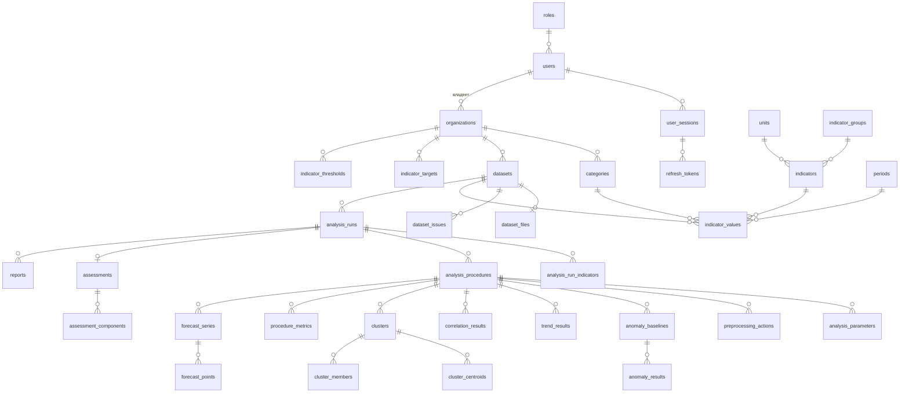

# База данных «Кризисная аналитика»

PostgreSQL 18, SQLAlchemy 2 (модели `backend/app/models/`), Alembic (`backend/alembic/versions/`). Схема приведена к третьей нормальной форме: 35 таблиц, каждая описывает одну сущность или одну связь.

## 1. Создание и обновление схемы

| Действие | Команда |
|---|---|
| Создать или обновить схему до последней ревизии | `python -m app.db.setup` |
| Проверить версию схемы (код 0 — актуальна, 5 — нет) | `python -m app.db.setup --check` |
| Автоматически при запуске сервера | `DB_MIGRATE_ON_STARTUP=true` (включено в Docker Compose) |
| Создать первого пользователя | `python -m app.cli create-user ...` (см. `backend/README.md`) |

Миграции: `0001` — все таблицы, ограничения и индексы; `0002` — справочники (роли `analyst` и `admin`, единицы `RUB`, `PCS`, `PCT`, группы `financial` и `operational`, 10 системных показателей из пояснительной записки). Учётные записи, организации и значения показателей миграции не создают. Одновременный запуск миграций несколькими экземплярами сервера исключён блокировкой `pg_advisory_xact_lock`.

Подключение настраивается переменными `DB_HOST`, `DB_PORT`, `DB_NAME`, `DB_USER`, `DB_PASSWORD`, `DB_SSLMODE`. Сервер ждёт СУБД при запуске (`DB_STARTUP_RETRIES`, `DB_STARTUP_RETRY_DELAY`), а потерю соединения во время работы возвращает клиенту как `503 database_unavailable`. Нарушение ограничения целостности, не перехваченное проверками сервиса, возвращается как `409 integrity_error`. Сервер работает под ролью `crisis_app` без прав суперпользователя.

## 2. Типы данных

| Данные | Тип | Обоснование |
|---|---|---|
| Значения показателей, в том числе денежные суммы; пороги, плановые значения, прогнозы, центры кластеров | `NUMERIC(20,4)` | Фиксированная точность без ошибок округления двоичной плавающей точки; 16 знаков целой части покрывают суммы до 1016 руб., 4 дробных — копейки и дробные натуральные показатели |
| Веса показателей, нормализованные оценки qj | `NUMERIC(6,5)` | Доли от 0 до 1 |
| Сводная оценка C | `NUMERIC(5,2)` | Шкала 0–100 |
| Числовые параметры методов | `NUMERIC(20,6)` | Точное воспроизведение введённых параметров |
| Статистики: z-оценки, коэффициенты корреляции, p-значения, наклон тренда, ошибки прогноза, координаты PCA | `DOUBLE PRECISION` | Результат вычислений с плавающей точкой в NumPy и SciPy; хранится без потери информации. Денежными величинами не являются |
| Отметки времени | `TIMESTAMPTZ` | Однозначный момент времени независимо от часового пояса узла |
| Периоды | `DATE` | Начало и конец периода |
| Перечисления (статусы, типы процедур, направление влияния) | `VARCHAR(32)` + `CHECK` | Добавление значения не требует `ALTER TYPE` |
| Идентификатор сеанса | `UUID` | Не угадывается и не раскрывает число сеансов |
| IP-адрес в журнале | `INET` | Проверка формата средствами СУБД |
| Зашифрованный файл, файл отчёта | `BYTEA` | Двоичные данные |

Первичные ключи — `GENERATED BY DEFAULT AS IDENTITY` (`indicator_values` и `audit_log` — `BIGINT`, так как это самые объёмные таблицы).

## 3. Таблицы

Обозначения: PK — первичный ключ, FK — внешний ключ (в скобках — правило при удалении родителя), UQ — уникальность, CK — проверка.

### 3.1 Пользователи и доступ

| Таблица | Столбцы | Ограничения |
|---|---|---|
| `roles` | `id` smallint, `code`, `name` | UQ `code` |
| `users` | `id`, `role_id`, `username`, `email`, `full_name`, `password_hash` (Argon2id), `is_active`, `failed_login_count`, `locked_until`, `created_at`, `last_login_at` | FK `role_id` → roles (RESTRICT); UQ `username`, UQ `email`; CK email в нижнем регистре и содержит `@`; CK формат логина `^[a-z0-9][a-z0-9._-]{2,49}$`; CK `failed_login_count >= 0` |
| `user_sessions` | `id` uuid, `user_id`, `created_at`, `expires_at`, `revoked_at`, `ip_address`, `user_agent` | FK `user_id` → users (CASCADE); CK `expires_at > created_at`; индекс (`user_id`, `revoked_at`) |
| `refresh_tokens` | `id`, `session_id`, `token_hash`, `issued_at`, `expires_at`, `used_at` | FK `session_id` → user_sessions (CASCADE); UQ `token_hash`; CK `token_hash` — 64 шестнадцатеричных символа (SHA-256, сам токен не хранится); CK `expires_at > issued_at` |
| `audit_log` | `id` bigint, `user_id`, `action`, `object_type`, `object_id`, `ip_address`, `created_at` | FK `user_id` → users (SET NULL: журнал сохраняется после удаления пользователя); индекс (`user_id`, `created_at`) |

### 3.2 Организации и справочники

| Таблица | Столбцы | Ограничения |
|---|---|---|
| `organizations` | `id`, `owner_id`, `name`, `description`, `created_at` | FK `owner_id` → users (RESTRICT); UQ (`owner_id`, `name`); CK непустое название |
| `categories` | `id`, `organization_id`, `name` | FK → organizations (CASCADE); UQ (`organization_id`, `name`) |
| `units` | `id`, `code`, `name`, `symbol` | UQ `code` |
| `indicator_groups` | `id`, `code`, `name` | UQ `code` |
| `indicators` | `id`, `code`, `name`, `unit_id`, `group_id`, `impact_direction`, `owner_id`, `description` | FK → units, indicator_groups, users (RESTRICT); UQ (`owner_id`, `code`) `NULLS NOT DISTINCT` — системный показатель (`owner_id IS NULL`) с данным кодом один; CK формат кода |
| `periods` | `id`, `granularity`, `start_date`, `end_date` | UQ (`granularity`, `start_date`); CK `end_date >= start_date`; CK период начинается с первого числа |
| `indicator_targets` | `id`, `organization_id`, `indicator_id`, `period_id`, `kind`, `value` | FK → organizations (CASCADE), indicators, periods (RESTRICT); UQ (`organization_id`, `indicator_id`, `period_id`, `kind`) `NULLS NOT DISTINCT` (`period_id IS NULL` — значение на все периоды) |
| `indicator_thresholds` | PK (`organization_id`, `indicator_id`), `lower_bound`, `upper_bound` | CK задана хотя бы одна граница; CK `lower_bound <= upper_bound` |

### 3.3 Наборы данных

| Таблица | Столбцы | Ограничения |
|---|---|---|
| `datasets` | `id`, `organization_id`, `uploaded_by`, `name`, `source_filename`, `source_sha256`, `granularity`, `created_at` | FK → organizations (CASCADE), users (RESTRICT); UQ (`organization_id`, `name`); CK формат SHA-256 |
| `dataset_files` | PK/FK `dataset_id`, `ciphertext`, `nonce`, `key_version` | FK → datasets (CASCADE); CK длина nonce 12 байт (AES-GCM); CK `key_version > 0`. Дубликат зашифрованного файла — `{DATA_DIR}/datasets/{id}.enc` |
| `dataset_issues` | `id`, `dataset_id`, `severity`, `code`, `row_number`, `column_name`, `message` | FK → datasets (CASCADE); CK `row_number >= 1` |
| `indicator_values` | `id` bigint, `dataset_id`, `indicator_id`, `period_id`, `category_id`, `value` | FK → datasets (CASCADE), indicators, periods, categories (RESTRICT); UQ (`dataset_id`, `indicator_id`, `period_id`, `category_id`) `NULLS NOT DISTINCT`; `value IS NULL` — пропуск в исходных данных |

### 3.4 Исследования и их параметры

| Таблица | Столбцы | Ограничения |
|---|---|---|
| `analysis_runs` | `id`, `dataset_id`, `created_by`, `parent_run_id`, `period_from_id`, `period_to_id`, `status`, `random_state`, `analytics_service_version`, `error_message`, `created_at`, `started_at`, `finished_at` | FK → datasets (CASCADE), users, periods (RESTRICT), self (SET NULL); CK `random_state >= 0`; CK завершение не раньше начала; CK запуск не является родителем самого себя |
| `analysis_run_indicators` | PK (`run_id`, `indicator_id`), `weight` | CK вес от 0 до 1 |
| `analysis_procedures` | `id`, `run_id`, `procedure_type`, `method`, `status`, `message`, `started_at`, `finished_at` | FK → analysis_runs (CASCADE); UQ (`run_id`, `procedure_type`) |
| `analysis_parameters` | PK (`procedure_id`, `name`, `position`), `numeric_value`, `text_value`, `boolean_value` | CK задано ровно одно значение (`num_nonnulls(...) = 1`); CK формат имени; `position` — номер элемента списочного параметра |

### 3.5 Результаты анализа

Все таблицы результатов удаляются каскадно вместе с процедурой (`ON DELETE CASCADE`), ссылки на показатели и периоды — `RESTRICT`.

| Таблица | Ключ и столбцы | Ограничения |
|---|---|---|
| `preprocessing_actions` | `id`; `procedure_id`, `indicator_id`, `period_id`, `action`, `new_value` | UQ (`procedure_id`, `indicator_id`, `period_id`) `NULLS NOT DISTINCT`; CK `imputed` требует период и новое значение, `excluded` — без значения |
| `anomaly_baselines` | PK (`procedure_id`, `indicator_id`); `center`, `lower_bound`, `upper_bound` | CK `lower_bound <= center <= upper_bound` |
| `anomaly_results` | PK (`procedure_id`, `indicator_id`, `period_id`); `score` | FK (`procedure_id`, `indicator_id`) → anomaly_baselines; CK `score <> 0` (знак — направление отклонения) |
| `trend_results` | PK (`procedure_id`, `indicator_id`); `slope`, `intercept`, `kendall_tau`, `p_value` | CK τ от −1 до 1, p от 0 до 1 |
| `correlation_results` | PK (`procedure_id`, `indicator_a_id`, `indicator_b_id`); `coefficient`, `p_value`, `n_observations` | CK `indicator_a_id < indicator_b_id` (каждая пара хранится один раз); CK коэффициент от −1 до 1 |
| `clusters` | PK (`procedure_id`, `cluster_number`); `label` | CK `cluster_number >= 0` |
| `cluster_centroids` | PK (`procedure_id`, `cluster_number`, `indicator_id`); `value` | FK (`procedure_id`, `cluster_number`) → clusters |
| `cluster_members` | PK (`procedure_id`, `period_id`); `cluster_number`, `pc1`, `pc2` | FK (`procedure_id`, `cluster_number`) → clusters; ключ гарантирует, что период входит в один кластер процедуры |
| `procedure_metrics` | PK (`procedure_id`, `metric_code`); `value` | CK формат кода |
| `forecast_series` | PK (`procedure_id`, `indicator_id`); `model_name`, `mae`, `rmse`, `mape` | CK ошибки неотрицательны |
| `forecast_points` | PK (`procedure_id`, `indicator_id`, `period_id`); `value`, `lower_bound`, `upper_bound` | FK (`procedure_id`, `indicator_id`) → forecast_series; CK `lower_bound <= value <= upper_bound` |
| `assessments` | PK/FK `run_id`; `score`, `created_at` | CK 0 ≤ `score` ≤ 100 |
| `assessment_components` | PK (`run_id`, `indicator_id`); `normalized_score`, `explanation` | FK `run_id` → assessments; FK (`run_id`, `indicator_id`) → analysis_run_indicators (оценивается только показатель, включённый в исследование); CK 0 ≤ q ≤ 1 |

### 3.6 Отчёты

| Таблица | Столбцы | Ограничения |
|---|---|---|
| `reports` | `id`, `run_id`, `created_by`, `title`, `format`, `status`, `created_at`, `generated_at`, `content` | FK → analysis_runs (CASCADE), users (RESTRICT); CK содержимое и время формирования заданы тогда и только тогда, когда `status = 'ready'`; `content` загружается отложенно |

## 4. Связи и удаление

Удаление организации удаляет её категории, наборы данных, пороги и плановые значения. Удаление набора удаляет значения, исследования, результаты и отчёты (REL-3). Справочники и пользователи, на которых ссылаются данные, удалить нельзя (`RESTRICT`). Удаление пользователя завершает его сеансы, а записи журнала сохраняются без ссылки.

## 5. Индексы

Кроме индексов первичных ключей и ограничений уникальности, созданы индексы на внешние ключи, по которым выполняются выборки и проверки при удалении: `indicator_values` (`indicator_id`, `period_id`, `category_id`; `dataset_id` — первый столбец уникального ключа), `analysis_runs` (`dataset_id`, `created_by`, `parent_run_id`, периоды), `reports` (`run_id`, `created_by`), а также ссылки результатов на показатели и периоды. Таблицы результатов не требуют отдельного индекса по `procedure_id`: он первый столбец первичного ключа.

## 6. Обоснование нормальных форм

**1НФ.** Все значения атомарны, повторяющихся групп нет:

- Значения показателей хранятся в «длинном» формате: одна строка — показатель × период × категория. Добавление показателя не меняет схему (NFR-02).
- Параметры процедур хранятся строками `analysis_parameters` с типизированными столбцами, а не документом JSON. Списочный параметр (например, набор моделей прогноза) — несколько строк с разным `position`.
- Результаты каждой процедуры лежат в отдельных таблицах с собственными типами и ограничениями, а не в общем поле.

**2НФ.** В таблицах с составным ключом каждый неключевой атрибут зависит от ключа целиком:

- Модель прогноза и её ошибки зависят от пары (процедура, показатель), поэтому вынесены в `forecast_series`, а не повторяются в каждой точке `forecast_points`.
- Границы нормы зависят от пары (процедура, показатель), поэтому вынесены в `anomaly_baselines`, а не повторяются в каждой аномалии.
- Название кластера зависит от (процедура, номер кластера) и хранится в `clusters`, а не в `cluster_members`.

**3НФ.** Транзитивных зависимостей неключевых атрибутов нет:

- Единица измерения, группа и направление влияния — свойства показателя (`indicators`), а не значения или результата.
- Владелец набора данных определяется через организацию и не дублируется в `datasets`; `uploaded_by` — отдельный факт (кто загрузил).
- Значение показателя в аномалии, исходное значение при предобработке, размер кластера, число наблюдений набора, уровень риска и вклад wj·qj не хранятся: они вычисляются запросом или по шкале в конфигурации.
- `periods.end_date` определяется потенциальным ключом (`granularity`, `start_date`), что допустимо в 3НФ. Хранение упрощает выборки по диапазону дат.
- В `user_sessions` нет данных пользователя, кроме ссылки; в `refresh_tokens` нет ссылки на пользователя — он определяется через сеанс.

**Составные ключи.** Кластер, базовый уровень аномалий и прогнозная модель идентифицируются естественными составными ключами. Поэтому правила «период принадлежит одному кластеру процедуры», «аномалия относится к показателю, для которого рассчитаны границы» и «оценивается только показатель исследования» обеспечиваются внешними и первичными ключами СУБД, а не кодом приложения.

## 7. Проверка

`backend/tests/integration/test_migrations.py` на тестовой PostgreSQL: откат до пустой схемы и повторное применение миграций, совпадение моделей и схемы (`alembic.autogenerate.compare_metadata` без различий), наличие справочников и отсутствие учётных записей. Операции чтения и записи, ограничения и каскадное удаление проверяются тестами API в том же каталоге.
